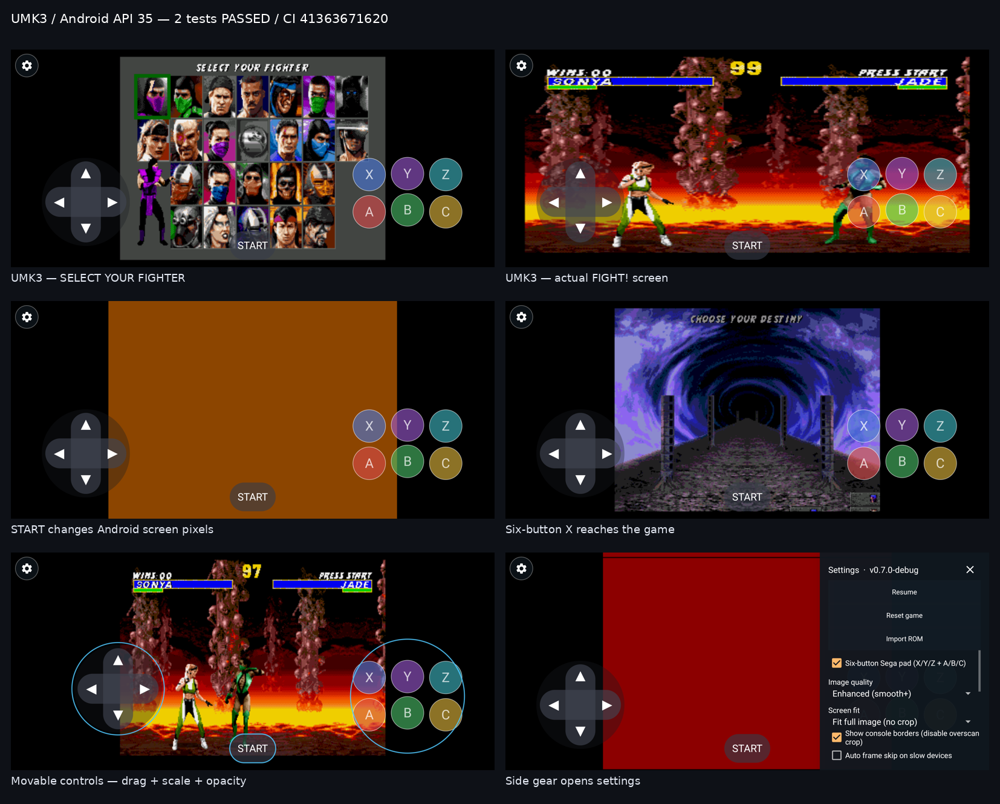

# سجل التحقق — UMK3 Android 0.7.0

آخر تحديث: **2026-11-01**. كود التطبيق والاختبارات الذي اجتاز الفحص: `31e59b9`.

## التنزيل

[إصدار GitHub v0.7.0-umk3](https://github.com/midoali250/umk3-android/releases/tag/v0.7.0-umk3) — أصل التنزيل `UMK3-Android-0.7.apk`.

- الحزمة: `com.midoali.umk3.v7`، الإصدار `0.7.0-umk3`، `versionCode=7`.
- الحد الأدنى Android 8.0 / API 26، والاستهداف API 35.
- المعماريات: `arm64-v8a`, `armeabi-v7a`, `x86_64`.
- حجم APK: **30,978,826 bytes**.
- SHA-256: `e9de93156202e8bc64a9a11489e8e0b7762fe871cecf923682976640b3c930a2`.
- تم تنزيل APK من GitHub بعد الرفع ومقارنة كل البايتات بالنسخة المحلية الموقعة: **مطابق**.

اللعبة المرفوعة مضمّنة في `assets/roms/game.md` داخل APK الشخصي وتفتح تلقائيًا. حجمها 4,194,304 bytes وSHA-256:
`75dd7e0c182a759a7e5beabbca7581ff11336c416fa4711804cf6f148fbc45c0`.
ملف اللعبة ليس في تاريخ Git المصدر؛ يجلبه CI من أصل خاص. بناء المصدر الافتراضي لا يضمّن لعبة.

## ما الذي ثبت على Android؟

[تشغيل GitHub Actions 41363671620](https://github.com/midoali250/umk3-android/actions/runs/41363671620): **SUCCESS**.

البيئة: محاكي Android **API 35، google_apis، x86_64، Pixel 6**، على Linux مع KVM وSwiftShader. تقرير instrumentation النهائي: **اختباران، 0 إخفاقات، 0 أخطاء، 0 تخطي**.

| الاختبار | النتيجة |
| --- | --- |
| `VideoInstrumentedTest.realAndroidScreenShowsGameAndTouchChangesPixels` | **نجح** — 44.962 ث |
| `ControlsInstrumentedTest.dispatchedMultitouchReachesRealGameAndSettingsPersist` | **نجح** — 106.647 ث |

الاختبار الثاني شغّل ملف UMK3 الحقيقي، ووصل إلى اختيار المقاتلين والمباراة، وفحص START والاتجاهات الأربعة وA/B/C وX/Y/Z، والضغط المتزامن، وأوضاع الصورة، ثم سحب D-pad وتغيير الحجم والشفافية واستعادتها بعد إعادة إنشاء Activity.

الصور مأخوذة من `UiAutomation.takeScreenshot()` داخل المحاكي، وليست إطارات نواة معاد رسمها على كمبيوتر أو صورًا مولّدة. اللقطات الكاملة وتقرير XML وlogcat مرفقة في `UMK3-Android-test-proof.zip` على الإصدار وفي artifacts تشغيل CI.

وظيفة **ARM64 native core pixels** نجحت أيضًا في التشغيل نفسه حتى الإطار 900. هذه حجة إضافية على إخراج النواة، وليست ادعاءً بتشغيل محاكي Android ARM64.

## الإصلاحان اللذان عالجَا الأعراض الفعلية

1. **تجميد الصورة/الشاشة السوداء:** مخزن الإطارات كان يبحث عن مخزن حر فقط، بينما تبقى مخازن READY القديمة غير محررة لأن العارض يحتفظ بأحدث إطار. بعد أول إطارات كان النشر يفشل، ومع ذلك يتقدم رقم الإطار المنشور ولا يعيد المحاولة. الآن يمكن إعادة تدوير READY غير المقروء، ولا يتقدم الرقم إلا بعد نشر ناجح.
2. **عدم تحريك الأزرار:** اختيار مجموعة السحب كان يفحص `pointerCount == 1` قبل إدخال أول إصبع وزيادة العداد، فكان دائمًا غير متحقق. أصبح يفحص `pointerCount == 0`. اختبار السحب والحفظ على Android نجح بعد الإصلاح.

لم يُستبدل المحرك أو ملف اللعبة لإخفاء الخطأ؛ الإصلاحان في طبقة تطبيق Android.

## فحوص البناء والتوقيع المحلية

- JDK 17، Gradle Wrapper 8.11.1، AGP 8.9.2، SDK 35، Build Tools 35.0.0، NDK 27.0.12077973، CMake 3.22.1.
- `:core:test`: **9 اختبارات ناجحة**.
- `:android:testReleaseUnitTest`: **اختباران ناجحان**.
- `:android:lintRelease`: **0 أخطاء، 19 تحذيرًا**.
- بناء وتصدير APK الشخصي: **BUILD SUCCESSFUL**.
- `apksigner verify`: توقيع **v2 صالح**؛ شهادة التوقيع SHA-256 `466bb6cc626a371bc92f81c51d4c59535c5f8dd50338f9e71507f0575fc97f92`.
- `zipalign -c -p 4`: **نجح**.
- مكتبات الاختبار `nativeTestInput` و`nativeTestRam` غير موجودة في مكتبات APK النهائي.
- إشعارات الطرف الثالث موجودة داخل APK، ومصدر Genesis Plus GX الكامل موجود في المستودع.

## حدود النتيجة

- هذا تحقق على **محاكي Android**، وليس على هاتف المستخدم فعليًا. لا يوجد ادعاء بأن كل أجهزة GPU أو كل إصدارات أندرويد اختُبرت.
- لقطات المباراة تثبت الصورة والتحكم أثناء اللعب، ولا تمثل قياس أداء طويل الأمد على هاتف فعلي.
- الترخيص غير التجاري للمحرك وملحقاته يظل ساريًا؛ راجع `THIRD_PARTY_NOTICES.txt`.
- الحزمة 0.7 مستقلة عن الحزمة القديمة لتجنب تعارض التوقيع. قد يلزم حذف القديمة قبل التثبيت، بعد حفظ البيانات.

إعادة إنتاج فحوص المصدر مشروحة في [BUILD_APK.md](BUILD_APK.md)، وبوابة Android في [DEVICE_VERIFICATION.md](DEVICE_VERIFICATION.md).
